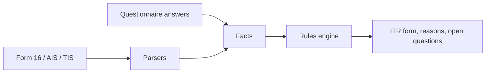
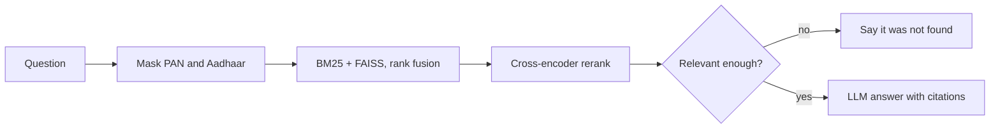

# TaxEase

**Find the right Income Tax Return form, and ask questions about Indian income tax law with citations.**

TaxEase reads a taxpayer's Form 16, AIS and TIS, asks for the facts no document can prove, and recommends which ITR form to file for **AY 2026-27 (FY 2025-26)**. A retrieval-augmented assistant answers questions from the Income-tax Acts, Rules and ITR instructions.

> TaxEase is decision support, not tax advice. It does not file returns. Verify important decisions at [incometax.gov.in](https://www.incometax.gov.in) or with a qualified professional.

## Contents

- [Features](#features)
- [How it works](#how-it-works)
- [Tech stack](#tech-stack)
- [Getting started](#getting-started)
- [Configuration](#configuration)
- [API reference](#api-reference)
- [Testing and evaluation](#testing-and-evaluation)
- [Deployment](#deployment)
- [Privacy and security](#privacy-and-security)
- [Project structure](#project-structure)
- [Known limitations](#known-limitations)

## Features

| Feature | What it does |
|---|---|
| **ITR form check** | Selects the form with a deterministic rules engine, explains which conditions failed, and marks the result *provisional* until open questions are answered |
| **Document parsing** | Extracts Form 16 (PDF), AIS and TIS (JSON) and reports conflicts between them |
| **Tax Q&A** | Hybrid search with reranking over the law corpus, with document, section and page citations |
| **Regime comparison** | Old versus new tax regime for an individual (API) |
| **Late-filing routes** | Belated, revised and updated return options with related fees and interest (API) |
| **Form 16 extraction** | OCR and LLM extraction into an editable review screen |

## How it works

### ITR selection is rules, not AI

The inputs to form selection are structured facts such as residency, income heads and limits, so a language model does not decide it. The rules live in [`itr_rules.yaml`](backend/rules/itr_rules.yaml) and each is tagged with how well it has been verified.



### Questions about the law use retrieval



- **Structure-aware chunking.** Law PDFs are split by section, so each chunk carries one section number and its Act version. Chunks are sized for the embedding model's input window.
- **1961 and 2025 kept apart.** Returns for AY 2026-27 fall under the Income-tax Act, 1961. The 2025 Act is used when a question asks about it.
- **Safe index updates.** Only changed chunks are re-embedded. A new index is validated before it goes live, and the previous version is kept.
- **Graceful failure.** If one retriever or the reranker fails, the rest still answers. If the language model fails, the most relevant passages are returned.
- **Observability.** Each request can be traced stage by stage. An optional second model scores answers for faithfulness and relevance.

## Tech stack

| Layer | Technology |
|---|---|
| Frontend | Next.js 16, React 19, TypeScript, Tailwind CSS |
| Backend | Python 3.11, FastAPI |
| Data and auth | PostgreSQL, SQLAlchemy, JWT, bcrypt |
| Retrieval | FAISS, BM25, `all-MiniLM-L6-v2` embeddings, `ms-marco-MiniLM-L-6-v2` cross-encoder |
| Language model | Groq API (`openai/gpt-oss-120b` by default) |
| Documents | PyMuPDF, Tesseract OCR |

## Getting started

### Prerequisites

- Python 3.11
- Node.js 20.9 or later
- PostgreSQL
- Tesseract OCR (for scanned documents)
- A [Groq API key](https://console.groq.com)
- About 1 GB of free RAM for the backend

### 1. Clone

```bash
git clone https://github.com/Dinesh5331/TaxEase.git
cd TaxEase
```

### 2. Add the reference documents

PDFs are not stored in Git. Without them the assistant only has the two text references in `backend/docs/eligibility/`.

Download them from official sources and place them as follows. The file names matter, because they determine how each document is labelled and cited.

| Path under `backend/docs/` | Document |
|---|---|
| `laws/Income-tax_Bill(1961).pdf` | Income-tax Act, 1961 (the Act, despite the file name) |
| `laws/Income-tax_Bill(1962).pdf` | Income-tax Rules, 1962 |
| `laws/Income-tax_Bill(2025)-amended(2026).pdf` | Income-tax Act, 2025, as amended by Finance Act 2026 |
| `laws/Finance_Bill-2026.pdf` | Finance Bill, 2026 |
| `Guidelines/itr_1-guidelines.pdf` … `itr_7-guidelines.pdf` | ITR filing instructions |

### 3. Start the backend

```bash
cd backend
python -m venv myenv
```

Activate the environment:

```powershell
.\myenv\Scripts\Activate.ps1      # Windows PowerShell
```

```bash
source myenv/bin/activate         # macOS / Linux
```

Install dependencies and create your configuration:

```bash
pip install -r requirements.txt
cp .env.example .env              # then edit .env
python -m uvicorn api.app:app --reload --port 8000
```

The search index is built on the first chat request. With the full corpus this takes several minutes on a CPU. To build it ahead of time:

```bash
python -c "from rag.main import setup; setup()"
```

Interactive API documentation is at <http://localhost:8000/docs>.

### 4. Start the frontend

In a second terminal:

```bash
cd taxeaseui
npm install
cp .env.example .env.local
npm run dev
```

Open <http://localhost:3000>, create an account, and choose **ITR Form Check**.

### Try it with synthetic data

[`backend/demo_data/`](backend/demo_data) holds 21 fictional taxpayer profiles covering common situations and edge cases. Upload a profile's `ais.json` and `tis.json` on the ITR Form Check page. To generate the matching Form 16 PDFs:

```bash
cd backend
python scripts/generate_demo_data.py
```

## Configuration

### Backend (`backend/.env`)

| Variable | Required | Purpose |
|---|---|---|
| `DATABASE_URL` | Yes | PostgreSQL connection string |
| `SECRET_KEY` | Yes | Signs login tokens. Use a long random value |
| `GROQ_API_KEY` | Yes | Language model access |
| `GROQ_MODEL` | No | Overrides the default model |
| `ALLOWED_ORIGINS` | No | Comma-separated CORS origins (default `http://localhost:3000`) |
| `RAG_TRACE_FILE` | No | Appends one JSON trace per request to this file |
| `RAG_JUDGE_SAMPLE` | No | Fraction of answers (0 to 1) to score with a second model. Off by default |
| `RAG_JUDGE_MODEL` | No | Model used for scoring |

### Frontend (`taxeaseui/.env.local`)

| Variable | Required | Purpose |
|---|---|---|
| `NEXT_PUBLIC_API_URL` | Yes | Backend base URL without a trailing slash. The production build fails without it |

## API reference

All routes are prefixed with `/api`.

| Method | Route | Purpose |
|---|---|---|
| `GET` | `/health` | Health check |
| `POST` | `/auth/signup` | Create an account |
| `POST` | `/auth/login` | Log in |
| `GET` | `/auth/me` | Current user |
| `GET` | `/itr/questionnaire` | Questions for facts documents cannot prove |
| `POST` | `/itr/analyze` | Recommend a form from AIS, Form 16, TIS and answers |
| `POST` | `/itr/select` | Run the rules engine on structured facts |
| `POST` | `/regime/compare` | Compare old and new regimes |
| `POST` | `/compliance/route` | Late, revised and updated return options |
| `POST` | `/chat` | Ask a tax question |
| `POST` | `/upload` | Extract a Form 16 and suggest next steps |

Example, using a demo profile:

```bash
cd backend/demo_data/p01_salaried_simple
curl -F ais=@ais.json -F tis=@tis.json -F 'answers={}' http://localhost:8000/api/itr/analyze
```

The `/chat` response includes `answer`, `citations`, `trace_id` and a `status`:

| Status | Meaning |
|---|---|
| `ok` | Answered from retrieved text |
| `not_in_documents` | The model found no answer in the passages |
| `no_relevant_context` | Nothing relevant was retrieved, so the model was not called |
| `llm_unavailable` | Model call failed; relevant passages are returned |
| `retrieval_failed` | Search is unavailable |
| `invalid_query` | Empty or unusable question |

## Testing and evaluation

Run from `backend/`:

```bash
python -m unittest discover -s tests     # unit and contract tests
python -m eval.run_eval engine           # rules engine against hand-labelled profiles
python -m eval.run_eval answers          # end-to-end Q&A (needs the index and a Groq key)
```

| Check | Current state |
|---|---|
| Rules engine | Matches all 21 hand-labelled synthetic profiles |
| Q&A answer quality | **Below its release threshold.** The golden set is a draft that no tax professional has reviewed |

The engine result shows agreement with the project's own labels. It is not a certification against the official forms. The answer evaluation uses a large share of a free Groq daily token allowance.

## Deployment

**Frontend (Vercel).** Set the project's root directory to `taxeaseui` and define `NEXT_PUBLIC_API_URL`.

**Backend.** [`backend/Dockerfile`](backend/Dockerfile) builds the API and bakes the models and index into the image:

```bash
cd backend
docker build -t taxease-api .
docker run -p 7860:7860 --env-file .env taxease-api
```

- Use a host with at least 1 GB of RAM; 512 MB is not enough.
- Place the reference PDFs before building, or the image will contain only the text references.
- The Docker image has not yet been build-tested.
- [`render.yaml`](render.yaml) is a starting blueprint for Render.

Read [Privacy and security](#privacy-and-security) before making the backend public.

## Privacy and security

**What the app does**

- Uploaded files are processed in a temporary file or in memory and removed after the request.
- PAN is masked in ITR analysis results and before document text or questions reach the language model.
- Aadhaar numbers are masked in chat questions.
- Request traces store a hash of the question, not its text.
- Accounts are stored in PostgreSQL with bcrypt-hashed passwords.

**What to know**

- Chat questions and Form 16 text are sent to Groq. Names, employer and salary figures are **not** masked in Form 16 text.
- `/chat`, `/upload`, `/itr/*`, `/regime/*` and `/compliance/*` **do not require authentication**. Add authentication and rate limits before any public deployment.
- Use the synthetic demo data for testing. Never commit real documents or secrets.

## Project structure

```text
TaxEase/
├── backend/
│   ├── api/           # FastAPI app and routes
│   ├── rules/         # ITR rules, engine, regime and compliance logic
│   ├── extractors/    # Form 16, AIS, TIS parsers and questionnaire
│   ├── services/      # Documents and answers to a recommendation
│   ├── rag/           # Chunking, index, retrieval, generation, tracing
│   ├── ocr/           # OCR and LLM extraction for uploads
│   ├── eval/          # Golden questions and evaluation harness
│   ├── tests/         # Test suite
│   ├── demo_data/     # Synthetic taxpayer profiles
│   └── docs/          # Reference corpus
├── taxeaseui/         # Next.js frontend
└── render.yaml
```

## Known limitations

- Covers AY 2026-27 only.
- AIS and TIS parsers were built against simplified synthetic documents, not real portal exports.
- AIS reports sale value rather than capital gain, so gains must be entered by the user.
- Some rules rest on secondary sources and still need confirmation against official instructions.
- The `/upload` flow still lets the language model suggest a form. Use **ITR Form Check** for the rules-based result.
- Question answering is weaker when a question names no form or section.

## Contributing

1. Create a branch from `main`.
2. Make your change and add tests.
3. Run the tests and `python -m eval.run_eval engine`.
4. Open a pull request describing the change.
